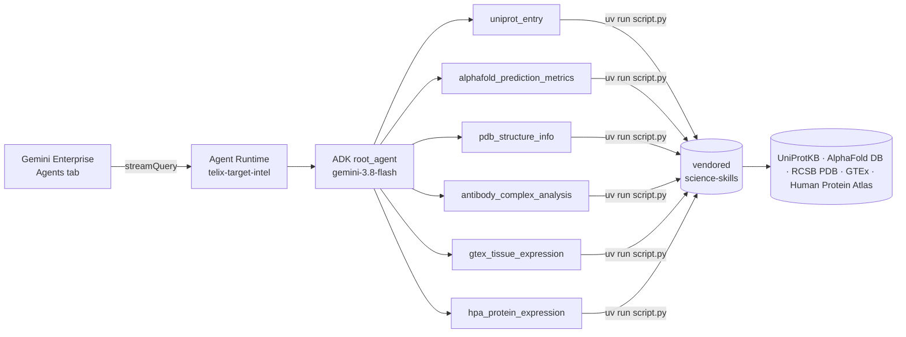

# Telix Target Intelligence Agent (Module 4)

An ADK agent whose tools **wrap DeepMind Science Skills scripts** (UniProt, AlphaFold DB, RCSB PDB, GTEx, Human Protein Atlas), deployed to
Vertex AI **Agent Runtime** (`europe-west4`) and registered in the Telix **Gemini Enterprise** app (`eu`).
It allows discovery, clinical, and regulatory colleagues to evaluate target biology, tissue expression, structural confidence,
and antibody complex developability directly from a conversational chat window—without requiring a local IDE.

```
bridge-agent/
├── app/
│   ├── agent.py                  root_agent: persona + tool list (gemini-3.8-flash)
│   ├── tools.py                  ADK function tools → science skill scripts
│   └── science_skills_runner.py  runs `uv run <skill>/scripts/<script> …` with rate limits
├── build.sh      scaffold (agents-cli) + overlay + vendor science-skills + Dockerfile patch + smoke test
├── deploy.sh     agents-cli deploy → Agent Runtime (EU)
├── publish.sh    agents-cli publish gemini-enterprise (ADK registration)
├── smoke_test.sh local + remote query
├── common.sh     loads .env, resolves PROJECT_NUMBER / GE resource name
└── .env.example
```

> **Versions.** This branch (`main`) holds the upgraded agent (six tools: UniProt, GTEx, Human Protein Atlas, AlphaFold DB, RCSB PDB, antibody-complex analysis): **Telix Target Intelligence** (`telix-target-intel`).
> Branch `antibody-first-pass-v1` holds the initial agent: **Telix Antibody First-Pass** (`telix-antibody-first-pass`).
> The two agents are separate Agent Runtime instances and separate Gemini Enterprise registrations, so
> deploying one **adds** an agent and does not replace the other. Both can run in the same project.

## How it works



- **Grounded tools:** Cover the target-assessment workflow (target biology → normal-tissue RNA and protein expression → structural confidence → 3D complex binding → developability liabilities & chelator pairing).
- **Execution:** Scripts run with `uv run` using their PEP 723 inline dependencies. `build.sh` ensures the container has `uv` and a pre-warmed cache.
- **Data residency:** Deployed to Agent Runtime in `europe-west4`; model inference on `location=eu` (`aiplatform.eu.rep.googleapis.com`); Gemini Enterprise app in `eu`.

## Build, deploy, publish

```bash
cp .env.example .env   # set PROJECT_ID, GE_APP_ID
./build.sh             # ~3–5 min; ends with a local smoke test
./deploy.sh            # ~5–10 min; deploys to Vertex AI Agent Runtime in europe-west4
./publish.sh           # registers in Gemini Enterprise with display name "Telix Target Intelligence"
./smoke_test.sh        # local + remote run of the demo question
```

## Demo question

> Profile HER2 (gene ERBB2, UniProt P04626) as a radioligand target: function and cellular location, normal-tissue RNA expression (GTEx), protein expression and subcellular location (Human Protein Atlas), AlphaFold structural confidence, and the binding interface and developability liabilities of the antibody in PDB 1N8Z.
